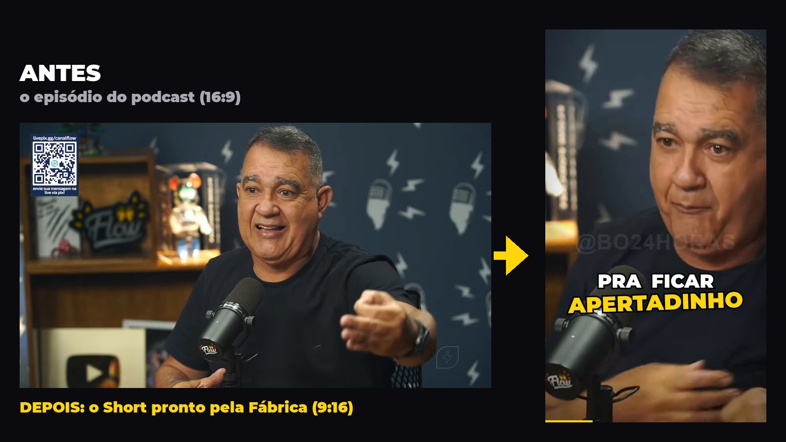

# Fábrica de Shorts

**Cortes de podcast no automático com o Claude Code.** A Fábrica minera os Shorts que viralizaram no seu nicho, acha o episódio original, baixa só o trecho, edita o vídeo em 9:16 (legenda, zoom no rosto, imagens, efeitos e trilha), confere tudo sozinha e te entrega o vídeo, a capa e o texto da postagem.

Skills da **Ilha dos Criadores** · feito pelo canal **Bora Pra Prática**.

[](https://ilhadoscriadores.tech/comunidade/zap?o=github)

[](https://youtube.com/shorts/zGUzjG6f8_0)

*Clique na imagem para ver o Short do canal BO 24 Horas no YouTube.*

## Instalar (2 comandos)

Abra o [Claude Code](https://claude.com/claude-code) numa **pasta nova e vazia** (por exemplo `Shorts automático`) e cole, um de cada vez:

```
/plugin marketplace add ilhadoscriadores/fabrica-de-shorts
```
```
/plugin install fabrica-de-shorts@ilha-dos-criadores
```

## Usar

1. **`/fabrica-de-shorts:comecar`**: confere o computador e instala o que falta (Python, FFmpeg, Node), cria a pasta de trabalho e pergunta o seu nicho, o seu @ e os canais que você admira. Leva uns 10 a 15 minutos na primeira vez.
2. **`/fabrica-de-shorts:cortes`**: faz um corte. No primeiro, ele te mostra referências de edição e pede o seu OK no estilo. Do segundo em diante é a **missão automática**: ele faz tudo sozinho e só te chama no fim.
3. Assistiu e quer mudar algo? É só falar ("a legenda ficou alta", "mais efeito de comédia"). Ele corrige, gera uma versão nova e grava a regra no seu `GUIA-DE-EDICAO.md` para os próximos cortes.
4. **`/fabrica-de-shorts:revisar`**: revisa qualquer vídeo antes de postar.

## O que ela faz

| Etapa | Como |
|---|---|
| Mineração | Busca os Shorts mais vistos do seu nicho (últimos 90 dias + campeões de até 2 anos) e monta uma planilha |
| Origem | Acha o episódio original e o minuto exato pela legenda; baixa **só o trecho** |
| Edição | Junta os trechos, encurta as pausas, coloca bip no palavrão e recorta em 9:16 seguindo o rosto, sem pulos |
| Legenda | Blocos de até 3 palavras, presos no começo **real** da voz (o Whisper erra até meio segundo) |
| Imagens | Geradas pelo Codex/ChatGPT quando você tem; sem ele, a lista do que gerar de graça |
| Som | Efeitos, trilha que abaixa quando a pessoa fala e volume final em −14 LUFS |
| Revisão | Confere tudo antes de entregar (veja abaixo) e escreve o `revisao.md` |
| Entrega | `final_v1.mp4`, capa, `POSTAGEM.txt` (título, legenda do TikTok, descrição com o crédito do podcast) e o tempo gasto |

**A revisão automática confere:** áudio e vídeo do mesmo tamanho, volume e pico, quadro preto ou congelado, legenda fora da voz (mais de 80 ms), legenda em cima do rosto, rosto cortado, palavrão com som e a área segura do Shorts. Se algo falha, ela corrige e roda de novo. Nenhum vídeo entregue é sobrescrito: a versão nova vira `final_v2.mp4`.

## Quanto custa

A Fábrica é grátis. O custo é o **limite de uso do seu plano do Claude**, que você já paga.

[CUSTO]

- O primeiro corte gasta mais, porque ele aprende o seu estilo.
- Cada corte roda num contexto novo: é por isso que fica barato. Para vários cortes seguidos, peça "faz 3 cortes" e ele abre um ajudante novo para cada um.
- Imagens: saem do seu plano do ChatGPT (Codex), ou de graça em outros sites.
- Todo o resto (Python, FFmpeg, Remotion, yt-dlp, Whisper) é grátis.

## O que você precisa

- **Windows 10 ou 11.** No macOS funciona em modo **experimental** (ainda não testado do zero).
- **Claude Code** com um plano pago da Anthropic.
- **~30 GB livres** e internet (o primeiro render baixa o navegador que monta o vídeo).
- Opcional: placa NVIDIA (transcrição mais rápida) e ChatGPT/Codex (imagens).

Os tempos do teste foram medidos num Ryzen 5 4600G com GTX 1060.

## Avisos

- **Nunca prejudique a imagem das pessoas.** Nada de corte que tire a fala do contexto, humilhe ou exponha alguém.
- **Crédito e autorização são responsabilidade de quem posta.** A Fábrica sempre coloca o crédito do podcast e o link do episódio, mas confira se o podcast libera cortes.
- **Remotion:** o editor de vídeo é grátis para pessoa física e para empresa pequena; empresa maior precisa de [licença](https://www.remotion.dev/license).
- **Trilhas e efeitos:** o plugin vem só com efeitos CC0. As trilhas (kit Mixkit) são baixadas por você, do próprio site, e cada licença fica anotada em `biblioteca/LICENCAS.md`.

## Licença

[PolyForm Shield 1.0.0](LICENSE): use, modifique e ganhe dinheiro com os seus vídeos à vontade; só não pode usar o código para oferecer um produto que concorra com a Fábrica de Shorts ou com a Ilha dos Criadores.

Peças de terceiros: fonte Montserrat (SIL OFL), detector de rosto YuNet do OpenCV Zoo (MIT), efeitos CC0 de Kenney, Qvantor e OpenGameArt (lista em `plugins/fabrica-de-shorts/assets/efeitos-cc0/LICENCAS.md`).

## Créditos

Feito pela **Ilha dos Criadores · Bora Pra Prática**. Quer receber as atualizações e os modos novos (cada vídeo novo do canal libera um)? [Entre nos Avisos da Ilha](https://ilhadoscriadores.tech/comunidade/zap?o=github).

---

## English summary

**Fábrica de Shorts** ("Shorts Factory") is a free Claude Code plugin that turns long podcast episodes into vertical Shorts automatically. It mines the most viewed Shorts in your niche, finds the original episode and the exact minute, downloads only that section, edits a 9:16 video in Remotion (face-tracking crop, word-highlight captions anchored to the real voice onset, images, sound effects, ducked music, −14 LUFS master), runs an automatic quality review (A/V length, loudness, black or frozen frames, caption-vs-voice sync, captions over the face, muted profanity) and delivers the video, a thumbnail and the post text.

```
/plugin marketplace add ilhadoscriadores/fabrica-de-shorts
/plugin install fabrica-de-shorts@ilha-dos-criadores
```
Then run `/fabrica-de-shorts:comecar` (setup) and `/fabrica-de-shorts:cortes` (one Short). Skills and messages are in Brazilian Portuguese; captions work in Portuguese, English and Spanish. Windows 10/11 is tested; macOS is experimental. Licensed under [PolyForm Shield 1.0.0](LICENSE).
